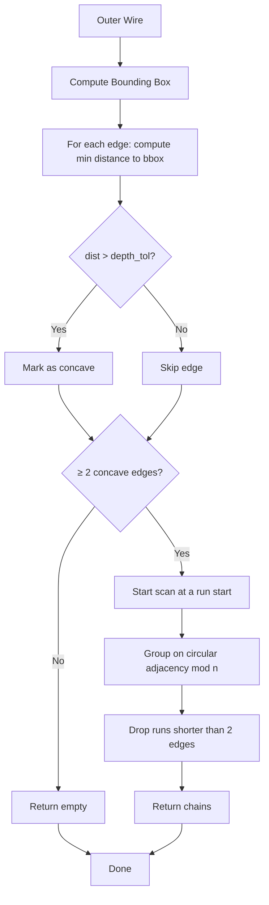

# Design Document — CAM-JetCutting

Architecture, algorithms, and FreeCAD integration details for the JetCutter Tools addon.

---

## Table of Contents

1. [Jet Cutting Premise](#jet-cutting-premise)
   - [Z is a machine value, not a part value](#z-is-a-machine-value-not-a-part-value)
   - [Operation property meanings](#operation-property-meanings)
   - [Ownership of pierce and cut heights](#ownership-of-pierce-and-cut-heights)
   - [Rules for contributors](#rules-for-contributors)
2. [Architecture](#architecture)
   - [Addon bootstrap](#addon-bootstrap)
   - [Workbench manipulator pattern](#workbench-manipulator-pattern)
   - [Command registration flow](#command-registration-flow)
3. [SameEdgesAsHighlighted](#sameedgesashighlighted)
   - [Algorithm overview](#algorithm-overview)
   - [Matching criteria](#matching-criteria)
   - [Visibility traversal](#visibility-traversal)
   - [Complexity](#complexity-1)
4. [FindProfiles](#findprofiles)
   - [Algorithm overview](#algorithm-overview-1)
   - [Top face detection](#top-face-detection)
   - [Edge matching via hashCode](#edge-matching-via-hashcode)
   - [Closed loop detection](#closed-loop-detection)
   - [Profile operation creation](#profile-operation-creation)
   - [Concave indentation detection](#concave-indentation-detection)
   - [Wire-contiguity validation](#wire-contiguity-validation)
   - [Complexity](#complexity-2)
5. [Constants & Configuration](#constants--configuration)

---

## Jet Cutting Premise

**Read this section before changing anything related to Z.**

This addon targets jet cutting machines: **plasma, laser and waterjet**. Two properties of those
machines drive most of the design decisions in this document.

### Z is a machine value, not a part value

**The CNC controller owns the Z axis.** The cut is single-pass — there is no stepdown — and the physical
height of the cutting nozzle is determined by factors the controller corrects dynamically on the machine
(torch height control, capacitive sensing, autofocus, kerf-dependent standoff). The CAM never decides it.

The consequence is that a Profile operation's Z is **not part geometry**. It is not a position above the
workpiece, and the absolute numbers do not correspond to anything physical on the model.

It is worth being precise about the common shorthand here, because the shorthand is wrong in an important
way. Z is not simply "dropped by the post-processor" — for a jet-capable post it is **repurposed**. The
post-processor reads the depth properties and uses them as the parameters of a three-state torch machine,
then emits them as machine setup metadata in the G-code header.

For example, the plasma post-processor reads:

```
pierce_height = op.StartDepth     (fallback 3.5 mm)
cut_height    = op.FinalDepth     (fallback 1.5 mm)
```

and emits `ph=` and `ch=` alongside `kw=` (kerf), `mt=` (material thickness), `fr=` (feed), `th=` (THC
state) and `pd=` (pierce delay). FreeCAD's bundled `Path/Post/scripts/generic_plasma_post.py` uses the same
properties for the same purpose, and additionally uses `ClearanceHeight` as its retract height.

So the correct statement is:

> CAM Z is irrelevant to **positioning** — the controller sets the real height. But `StartDepth`,
> `FinalDepth` and `ClearanceHeight` are **consumed by the post-processor as machine parameters**, and the
> values written into them are the ones the machine will be told.

### Operation property meanings

| Property | Meaning for jet cutting | Who owns the value |
|----------|-------------------------|--------------------|
| `StartDepth` | Pierce height — torch standoff before cutting | Post-processor / ToolController |
| `FinalDepth` | Cut height — torch standoff while cutting | Post-processor / ToolController |
| `ClearanceHeight` | Retract height; post emits `G0` to this between operations | FreeCAD (stock-anchored expression) |
| `SafeHeight` | Feed-travel height | FreeCAD (stock-anchored expression) |
| `StepDown` | **Unused** — the cut is single-pass | n/a |
| `Direction` | Travel direction; determines the lead-in side | This addon |
| `Side` / `UseComp` | Kerf compensation side | This addon |

One invariant is genuinely load-bearing, because the post derives torch state from it:

```
ClearanceHeight  >  StartDepth  >  FinalDepth
```

FreeCAD's stock-anchored default expressions already satisfy this, and they adapt when the user changes the
stock. That is why the addon leaves them alone.

### Ownership of pierce and cut heights

The addon does **not** set pierce or cut heights, and must not.

Those values are machine, torch and material facts. They will ultimately be held on the **ToolController**,
which a later version of FreeCAD is expected to provide. Until then, it is the **post-processor's
responsibility** to collect them from wherever they are held and present them in the G-code for the machine
controller.

The addon is deliberately version-agnostic about this. It creates operations and lets the post handle the
machine-facing parameters. It should not guess, and it should not derive them from geometry.

### Rules for contributors

1. **Never write a part coordinate into a Z property.** Not the face Z, not the model bounding box, not a
   hardcoded constant. The post reads these as torch heights; part geometry leaking in produces wrong
   machine data (for example a pierce height of 51 mm on a part that sits at Z = 50).
2. **Never set `StepDown` or describe a cut as multipass.** The cut is single-pass.
3. **Do not "fix" the depth properties to match the model.** FreeCAD binds stock-anchored expressions to
   them at creation time; a plain assignment to an expression-bound property is silently discarded, so an
   apparent fix is a no-op that reads as if it worked.
4. **The lead-in is the pierce point.** For narrow or irregular cutouts the start position is the
   safety-critical output of this addon, which is why each cutout gets its own operation.

---

## Architecture

### Addon bootstrap

FreeCAD's addon loader (`DirModGui` in `FreeCADGuiInit.py`) discovers addons by looking for `InitGui.py` at the package root. It has no mechanism for discovering workbench manipulators registered from within a namespace package (`freecad.jetcutter_tools.init_gui`).

The bootstrap chain:

```
package.xml <workbench> tag
    → DirModGui.process_metadata() reads metadata
    → FreeCADInit.py ExtModScanner scans freecad.* namespace
    → BUT: DirModGui.run_init_gui() only runs InitGui.py at addon root
    → InitGui.py (shim) imports freecad.jetcutter_tools.init_gui
    → init_gui.py registers commands + manipulator
```

**File:** `InitGui.py` — a 2-line shim that imports the real module.
**File:** `freecad/jetcutter_tools/init_gui.py` — registers two commands and the manipulator.

### Workbench manipulator pattern

The addon uses FreeCAD's **Workbench Manipulator** API (introduced in FreeCAD 1.1) to contribute a custom toolbar to the existing CAM Workbench, rather than defining a full workbench.

```
Manipulator.modifyToolBars()
    ├── Called by FreeCAD when the target workbench activates
    ├── Checks if current workbench == "CAMWorkbench"
    ├── Returns list of toolbar modification dicts:
    │   ├── {"append": "JetCutter Tools", "toolBar": ""}      → creates toolbar
    │   ├── {"append": "JetCutter_SameEdges", "toolBar": "JetCutter Tools"}
    │   └── {"append": "JetCutter_FindProfiles", "toolBar": "JetCutter Tools"}
    └── First call creates the toolbar; subsequent calls append commands
```

The `active_workbench_name()` helper works around a FreeCAD quirk: `FreeCADGui.activeWorkbench().name()` raises `AttributeError` during a core workbench's first activation. The name is recovered by identity comparison against `FreeCADGui.listWorkbenches()`.

### Command registration flow

```
init_gui.py
    ├── FreeCADGui.addIconPath("Resources/Icons")
    ├── FreeCADGui.addCommand("JetCutter_SameEdges", SameEdgesAsHighlighted())
    ├── FreeCADGui.addCommand("JetCutter_FindProfiles", FindProfiles())
    └── FreeCADGui.addWorkbenchManipulator(Manipulator())
```

Each command class implements the FreeCAD `Gui::Command` interface:
- `IsEnabled()` — determines if the button is active (depends on selection state)
- `Activated()` — executes the command logic
- `GetResources()` — returns icon name, menu text, and tooltip

---

## SameEdgesAsHighlighted

### Algorithm overview

Finds and selects all edges across all visible solids in the active document that match a **template profile** defined by the user's initial edge selection.

```
1. User selects one or more edges on any visible solid
2. Extract template: list of (edge_length, edge_Z) pairs from selected edges
3. Compute average Z-level from all selected edges
4. Clear selection
5. For each document object (excluding groups/parts):
   a. Skip if not visible (ancestor chain check)
   b. For each edge in the object's shape:
      i.   Check if edge Z ≈ average template Z (tolerance: 0.001mm)
      ii.  Check if edge length matches ANY template edge length (tolerance: 0.001mm)
      iii. If both match, add to selection
6. Report total matched edges
```

### Matching criteria

Two conditions must both be satisfied for an edge to match:

| Criterion | Method | Tolerance |
|-----------|--------|-----------|
| **Z-level** | `edge.CenterOfMass.z` vs `avg_target_z` | 0.001 mm |
| **Length** | `edge.Length` vs each `target["length"]` | 0.001 mm |

The Z-level check is a single comparison against the **average** Z of all selected template edges. This allows the user to select edges at slightly different Z positions (e.g. angled cuts) and still match.

The length check is an **any-match** against all template edge lengths. If the user selects 3 edges with lengths [10, 15, 20], any edge matching **any** of those lengths (at the correct Z) will be selected.

### Visibility traversal

The `is_effectively_visible()` function implements a recursive ancestor chain check:

```
is_effectively_visible(obj, gui_doc, visited):
    ├── Cycle detection: if obj in visited, return True (prevent infinite recursion)
    ├── GUI visibility: if obj.ViewObject.Visibility == False, return False
    └── Ancestor chain: for each obj in obj.InList:
        └── Recursively check ancestor; if any is invisible, return False
    └── Return True (all ancestors visible)
```

This ensures that an object hidden inside an invisible parent group is not processed, even if its own visibility flag is True.

**Complexity:** O(V × A) where V = visible objects, A = max ancestor chain depth.

### Complexity

| Phase | Complexity | Notes |
|-------|------------|-------|
| Template extraction | O(S) | S = number of selected sub-elements |
| Document traversal | O(D × E) | D = document objects, E = edges per object |
| Edge matching | O(E × T) | T = number of template edges |
| Visibility check | O(V × A) | V = visible objects, A = avg ancestor depth |
| **Total** | **O(D × E × T + V × A)** | Dominated by edge scanning |

With typical CAM models (D ≈ 50, E ≈ 1000, T ≈ 5), this runs in well under a second.

---

## FindProfiles

### Algorithm overview

Creates CAM Profile operations for **internal edges** (holes, cutouts) on the top faces of a selected CAM Job's model. Optionally detects and creates operations for **concave indentations** in the outer wire.

```
1. User selects a CAM Job object
2. Dialog: configure Tool, Offset Side, Cut Direction, LeadInOut, Concave Detection
3. Locate Model folder in Job.OutList
4. Extract first model clone (LinkedObjectGroup with Shape)
5. Build source edge hash map: hashCode → index for all source edges
6. Find top-facing flat faces on model (normal.z > 0.99)
7. For each top face:
   ├── For each inner wire (closed, not outer boundary):
   │   ├── Match wire edges to source edges via hashCode
   │   ├── If ≥ 2 edges matched: create Profile operation
   │   └── Increment closed_loop_count
   └── If concave detection enabled:
       ├── Compute bounding box of outer wire
       ├── Find concave edge chains (edges deep inside bbox)
       ├── Validate chains don't form closed wires
       └── Create Profile operation for each valid chain
8. Commit transaction, recompute document
```

### Top face detection

A face is considered "top-facing" if its normal vector has a Z-component greater than 0.99:

```
for face in source_obj.Shape.Faces:
    u_min, u_max, v_min, v_max = face.ParameterRange
    u_mid = u_min + (u_max - u_min) / 2.0
    v_mid = v_min + (v_max - v_min) / 2.0
    normal = face.normalAt(u_mid, v_mid)
    if normal.z > 0.99:
        → top face
```

The threshold 0.99 (instead of 1.0) allows for slight face tilts. The face midpoint is sampled because FreeCAD faces may have varying normals across their surface (though for planar faces, any point suffices).

### Edge matching via hashCode

The model clone's edges are geometrically identical to the source object's edges but have different memory addresses. FreeCAD's `hashCode()` method provides a stable identifier for edges that is consistent across geometrically identical edges.

```
src_hash_to_index = {e.hashCode(): i for i, e in enumerate(source_edges)}

for wire_edge in wire.Edges:
    src_idx = src_hash_to_index.get(wire_edge.hashCode())
    if src_idx is not None:
        edge_names.append(f"Edge{src_idx + 1}")
```

This maps each wire edge back to its corresponding edge on the model clone by index. The resulting `edge_names` list (e.g. `["Edge1", "Edge3", "Edge7"]`) is used to assign the correct sub-elements to the Profile operation's `Base` property.

**Why hashCode and not geometric comparison?** HashCode is O(1) lookup vs O(N) geometric comparison per edge. For large models with thousands of edges, this is a significant optimization.

### Closed loop detection

For each top face, the algorithm iterates over all wires:

```
outer_hash = face.OuterWire.hashCode()
for wire in face.Wires:
    if wire.hashCode() == outer_hash:
        continue          # skip outer boundary
    if not wire.isClosed():
        continue          # only process closed loops
    → process as internal hole/cutout
```

Only **closed** inner wires are processed. Open wires (e.g. scratches, artifacts) are skipped. The outer boundary wire is explicitly excluded.

### Profile operation creation

Extracted into a shared factory function `create_profile_operation()` (commands.py:577). This function is called by both the closed-loop and concave-chain code paths.

```
create_profile_operation(op_name, job, tool_controller, edge_names, model_clone,
                         offset_side, cut_direction, leadIn, leadOut, styleIn, styleOut,
                         lengthMultiplier):
    ├── PathProfileOp.Create(op_name, parentJob=job)
    ├── Set ToolController
    ├── Set ViewObject.Proxy (with setDeleteObjectsOnReject(False))
    ├── Build Base: [(model_clone, [edge_name, ...])]
    ├── Set Direction and Side/UseComp
    ├── Call add_leadinout_dressup()
    └── Return profile_op or None
```

The `Base` property format is a list of `(DocumentObject, [sub-element names])` tuples. FreeCAD expects this structure to associate geometric sub-elements with the operation.

**Offset side logic:**

| offset_side | UseComp | Side | Meaning |
|-------------|---------|------|---------|
| `"None"` | `False` | — | No edge offset (cut on geometry) |
| `"Inside"` | `True` | `"Inside"` | Compensate inward (kerf correction) |
| `"Outside"` | `True` | `"Outside"` | Compensate outward (kerf correction) |

### Concave indentation detection

Concave indentations are recessed features on the outer boundary of a part — think a "C" shape cut into a rectangular edge, or a series of notches. The algorithm detects these by finding chains of edges that extend significantly inward from the bounding box.

#### Step 1: Bounding box computation

```
bb_min_x = bb_min_y = +∞
bb_max_x = bb_max_y = -∞
for edge in outer_wire.Edges:
    for vertex in edge.Vertexes:
        bb_min_x = min(bb_min_x, vertex.X)
        bb_max_x = max(bb_max_x, vertex.X)
        bb_min_y = min(bb_min_y, vertex.Y)
        bb_max_y = max(bb_max_y, vertex.Y)
```

#### Step 2: Concave edge identification

For each edge, compute its minimum distance to the bounding box boundary:

```
dist = min(
    v.X - bb_min_x,           # distance from left edge
    bb_max_x - v.X,           # distance from right edge
    v.Y - bb_min_y,           # distance from bottom edge
    bb_max_y - v.Y,           # distance from top edge
)
if dist > concave_depth_tol:
    → edge is concave
```

An edge is classified as concave if **any** of its vertices lies deeper than `concave_depth_tol` (default 5mm) inside the bounding box. This captures edges that "recess" into the part.

#### Step 3: Chain formation

A wire is a closed loop, so its edge indices form a **circle**: index `n - 1` is adjacent to index `0`.
Concave edges are therefore grouped into runs of *circularly consecutive* indices.

Two things are needed, and neither is sufficient on its own:

1. **Start the scan at an index that begins a run**, so no run straddles the seam.
2. **Compare adjacency modulo the edge count**, so a run that legitimately wraps from the last index
   back to the first stays joined.

```
n = len(edges)
concave_set = set(concave_indices)

# 1. start at a run start, so the seam never cuts a run in half
start = next(
    (i for i in range(n)
     if i in concave_set and (i - 1) % n not in concave_set),
    concave_indices[0],
)
# 2. walk n indices from there, wrapping; keep the wrapped value
ordered = [i % n for i in range(start, start + n) if i % n in concave_set]

# 3. group on circular adjacency
for a, b in pairwise(ordered):
    if (b - a) % n == 1:          # circularly consecutive
        current_chain.append(b)
    else:
        chains.append(current_chain)
```

Example — a 15-edge wire with notches at indices 3-5, 7-9 and a wrap-around notch at 14-0-1:

```
concave_indices = [0, 1, 3, 4, 5, 7, 8, 9, 14]
start   = 3
ordered = [3, 4, 5, 7, 8, 9, 14, 0, 1]

→ chains: [3, 4, 5]   [7, 8, 9]   [14, 0, 1]
```

Minimum chain length is 2 edges — a single concave edge is not a meaningful indentation, and is
dropped. Note that `14, 0, 1` is one run of three, not three runs of one: without the circular adjacency
test the seam would split it and all three fragments would be discarded, silently losing the notch.

#### Why circular grouping is not optional

An earlier implementation grouped consecutive indices linearly and then patched up a "wrap-around" case
afterwards. It was wrong in two ways:

- One branch was **unreachable**. `concave_indices` is always ascending, so with two or more entries
  `concave_indices[0] < concave_indices[-1] <= n - 1`; a test for `concave_indices[0] == n - 1` can never
  be true.
- The reachable branch **merged every concave chain on the wire into one**. A part with three separate
  notches produced a single chain spanning all of them, and because the merged chain is not closed, the
  closure check in the caller did not catch it. The operation was created, and the resulting toolpath
  traversed across the part instead of following the notches.

Whether the bug fired depended on where `Part.__sortEdges__` happened to place the wire's seam. Measured
across every rotation of the input vertex order, the old code merged wrongly in **4 of 11** rotations for a
two-notch outline and **6 of 15** for a three-notch outline — roughly 40% of cases, not a rare edge case.

The contiguity check below is a belt-and-braces guard against the same class of failure.

#### Visual representation

**Regular indentation** — a notch on the right edge:

```
+----0----+
|         |
|         1
|         |
|     +-2-+
|     |
7     3 
|     |
|     +-4-+
|         |
|         5
|         |
+----6----+
```

The notch creates concave edges 2, 3, 4 whose vertices extend inward past the depth tolerance. These form chain `[2, 3, 4]`.

**Wrap-around indentation** — a notch at the corner, spanning from the last edge to the first edge of the wire:

```
+---4---+
|       |
|       5
|       |
3       +-0-+
|           |
|           1
|           |
+-----2-----+
```

The notch creates concave edges 0 and 5, whose vertices extend inward past the depth tolerance.
Edges 1, 2, 3 and 4 lie on the bounding box and are excluded. Because 5 and 0 are adjacent across the
wire seam, the circular grouping in Step 3 produces the single chain `[5, 0]`. A linear scan would have
produced two runs of one edge each and discarded both, silently losing the notch.

#### Mermaid diagram — concave detection flow



### Wire-contiguity validation

Each chain is mapped back to the model clone's edges, then checked for **contiguity** — whether the edges
form one connected end-to-end run:

```
matched_edges = [clone.Shape.getElement(name) for name in edge_names]
ordered = Part.__sortEdges__(matched_edges)
if not is_contiguous_run(ordered):
    skip + warn
```

`Part.__sortEdges__()` orders the edges into a wire sequence, and `is_contiguous_run()` walks that
sequence verifying each edge shares an endpoint with the one before it. If they do not all join, the
chain is actually several separate features concatenated together, and profiling them as one operation
would drive the tool **across the part** rather than along an indentation.

This is a different failure from a closed wire, and needs a different test. A merged chain is not closed,
so a closure check passes it:

```
test_wire = Part.Wire(ordered)
if test_wire.isClosed():
    skip  # closed wire — a complete loop, already handled by closed-loop detection
```

Both checks are applied. Contiguity is the safety-critical one: a false negative here means a cut the
user never asked for.

### Complexity

| Phase | Complexity | Notes |
|-------|------------|-------|
| Hash map construction | O(E) | E = source edges |
| Top face detection | O(F) | F = faces per model |
| Wire iteration | O(W × E_w) | W = wires per face, E_w = edges per wire |
| Edge matching | O(E_w) | O(1) hashCode lookup per edge |
| Concave detection | O(E_outer) | E_outer = outer wire edges |
| Chain formation | O(C) | C = concave edges; circular scan, still one pass |
| Contiguity check | O(E_chain²) | Walk-based; E_chain is small (a few edges) |
| **Total per face** | **O(E_total)** | Linear in total edge count |

The algorithm is efficient because hashCode lookups are O(1) and each edge is processed a constant number of times.

---

## Constants & Configuration

### Tolerance values

| Constant | Value | Purpose |
|----------|-------|---------|
| Edge matching tolerance | 0.001 mm | Length and Z-level comparison |
| Top face normal threshold | 0.99 | Allow slight face tilt |

### Cutting parameters (Z)

The addon sets **no** Z properties. See [Jet Cutting Premise](#jet-cutting-premise) — the post-processor
owns pierce and cut heights, and the Z axis is driven by the machine controller.

FreeCAD binds stock-anchored expressions to these at operation-creation time, and they are left intact:

| Parameter | Source | Meaning for jet cutting |
|-----------|--------|-------------------------|
| ClearanceHeight | `OpStockZMax + SetupSheet.ClearanceHeightOffset` | Retract height |
| SafeHeight | `OpStockZMax + SetupSheet.SafeHeightOffset` | Feed-travel height |
| StartDepth | `OpStartDepth` | Pierce height (post reads it) |
| FinalDepth | `OpFinalDepth` | Cut height (post reads it) |
| StepDown | `OpToolDiameter` | Unused — single-pass cut |

A plain assignment to any of these is **silently discarded** by FreeCAD, because the expression binding
takes precedence. Setting them does nothing, and reads as though it worked.

### Dialog defaults

| Setting | Default | Purpose |
|---------|---------|---------|
| Lead In | Enabled | Add lead-in to toolpath |
| Lead Out | Disabled | Add lead-out to toolpath |
| Lead In/Out Style | "Perpendicular" | Entry/exit angle |
| Length Multiplier | 3.0 × tool diameter | Lead length |
| Concave Detection | Enabled | Detect concave indentations |
| Concave Depth Tol | 5.0 mm | Min depth for concave classification |
